# Task Index (generated — do not edit by hand)

Regenerate with `python3 tasks/tools/taskctl.py index`. Source of truth: `tasks/items/*.md`.

**Progress:** 30/111 done · ready now: T009, T010, T011, T046, T047, T049, T055, T070, T073, T080, T090, T092, T093, T100, T105, T122, T127, T141, T142, T154

Legend: ⬜ todo · 🔄 in progress · 👀 review · ✅ done · ⛔ blocked

## Dependency graph

```mermaid
flowchart LR
  classDef done fill:#c8e6c9,stroke:#2e7d32
  classDef prog fill:#fff3c4,stroke:#f9a825
  classDef rev fill:#e1f5fe,stroke:#0277bd
  classDef blk fill:#ffcdd2,stroke:#c62828
  classDef todo fill:#eeeeee,stroke:#9e9e9e
  subgraph P0
    T001["T001"]:::done
    T002["T002"]:::done
    T003["T003"]:::done
    T004["T004"]:::done
    T005["T005"]:::done
    T006["T006"]:::done
    T007["T007"]:::done
    T008["T008"]:::done
    T009["T009"]:::todo
    T010["T010"]:::todo
    T011["T011"]:::todo
    T012["T012"]:::done
  end
  subgraph P1
    T020["T020"]:::done
    T021["T021"]:::done
    T022["T022"]:::done
    T023["T023"]:::done
    T024["T024"]:::done
    T025["T025"]:::done
    T026["T026"]:::done
    T027["T027"]:::done
    T028["T028"]:::done
    T029["T029"]:::done
    T030["T030"]:::done
    T031["T031"]:::done
    T032["T032"]:::done
    T033["T033"]:::done
    T034["T034"]:::done
  end
  subgraph P2
    T040["T040"]:::done
    T041["T041"]:::done
    T042["T042"]:::done
    T043["T043"]:::done
    T044["T044"]:::done
    T045["T045"]:::done
    T046["T046"]:::todo
    T047["T047"]:::todo
    T048["T048"]:::todo
    T049["T049"]:::todo
    T050["T050"]:::todo
    T051["T051"]:::todo
    T052["T052"]:::todo
    T053["T053"]:::todo
    T054["T054"]:::todo
    T055["T055"]:::todo
  end
  subgraph P3
    T060["T060"]:::todo
    T061["T061"]:::todo
    T062["T062"]:::todo
    T063["T063"]:::todo
    T064["T064"]:::todo
    T065["T065"]:::todo
    T066["T066"]:::todo
    T067["T067"]:::todo
    T068["T068"]:::todo
  end
  subgraph P4
    T070["T070"]:::todo
    T071["T071"]:::todo
    T072["T072"]:::todo
    T073["T073"]:::todo
    T074["T074"]:::todo
    T075["T075"]:::todo
    T076["T076"]:::todo
    T077["T077"]:::todo
    T078["T078"]:::todo
    T079["T079"]:::todo
    T080["T080"]:::todo
    T081["T081"]:::todo
    T082["T082"]:::todo
  end
  subgraph P5
    T090["T090"]:::todo
    T091["T091"]:::todo
    T092["T092"]:::todo
    T093["T093"]:::todo
    T094["T094"]:::todo
    T095["T095"]:::todo
  end
  subgraph P6
    T100["T100"]:::todo
    T101["T101"]:::todo
    T102["T102"]:::todo
    T103["T103"]:::todo
    T104["T104"]:::todo
    T105["T105"]:::todo
    T106["T106"]:::todo
    T107["T107"]:::todo
    T108["T108"]:::todo
    T109["T109"]:::todo
    T110["T110"]:::todo
    T111["T111"]:::todo
    T112["T112"]:::todo
    T113["T113"]:::todo
  end
  subgraph P7
    T120["T120"]:::todo
    T121["T121"]:::todo
    T122["T122"]:::todo
    T123["T123"]:::todo
    T124["T124"]:::todo
    T125["T125"]:::todo
    T126["T126"]:::todo
    T127["T127"]:::todo
    T128["T128"]:::todo
  end
  subgraph P8
    T140["T140"]:::todo
    T141["T141"]:::todo
    T142["T142"]:::todo
    T143["T143"]:::todo
    T144["T144"]:::todo
  end
  subgraph P9
    T150["T150"]:::todo
    T151["T151"]:::todo
    T152["T152"]:::todo
    T153["T153"]:::todo
    T154["T154"]:::todo
    T155["T155"]:::todo
    T156["T156"]:::todo
    T157["T157"]:::todo
    T158["T158"]:::todo
    T159["T159"]:::todo
    T160["T160"]:::todo
    T161["T161"]:::todo
  end
  T001 --> T002
  T001 --> T003
  T001 --> T004
  T001 --> T005
  T004 --> T006
  T001 --> T007
  T001 --> T008
  T007 --> T008
  T001 --> T012
  T005 --> T020
  T020 --> T021
  T004 --> T022
  T020 --> T022
  T021 --> T023
  T004 --> T023
  T023 --> T024
  T023 --> T025
  T023 --> T026
  T005 --> T027
  T005 --> T028
  T004 --> T029
  T006 --> T029
  T005 --> T030
  T021 --> T031
  T021 --> T032
  T022 --> T032
  T026 --> T032
  T020 --> T033
  T004 --> T033
  T023 --> T034
  T005 --> T040
  T005 --> T041
  T022 --> T042
  T023 --> T042
  T022 --> T043
  T023 --> T043
  T042 --> T044
  T043 --> T044
  T040 --> T045
  T044 --> T045
  T029 --> T045
  T045 --> T046
  T041 --> T046
  T040 --> T047
  T044 --> T047
  T029 --> T047
  T047 --> T048
  T041 --> T048
  T029 --> T049
  T040 --> T050
  T049 --> T050
  T022 --> T050
  T050 --> T051
  T041 --> T051
  T050 --> T052
  T042 --> T053
  T043 --> T053
  T050 --> T053
  T052 --> T053
  T053 --> T054
  T008 --> T054
  T055 --> T054
  T005 --> T055
  T007 --> T055
  T045 --> T060
  T047 --> T060
  T050 --> T060
  T021 --> T060
  T060 --> T061
  T033 --> T061
  T060 --> T062
  T060 --> T063
  T062 --> T064
  T008 --> T064
  T055 --> T064
  T062 --> T065
  T027 --> T065
  T028 --> T065
  T063 --> T066
  T064 --> T066
  T062 --> T067
  T034 --> T068
  T060 --> T068
  T005 --> T070
  T029 --> T070
  T070 --> T071
  T070 --> T072
  T022 --> T073
  T021 --> T073
  T073 --> T074
  T070 --> T074
  T074 --> T075
  T073 --> T076
  T073 --> T077
  T008 --> T077
  T055 --> T077
  T074 --> T078
  T077 --> T078
  T075 --> T079
  T076 --> T079
  T077 --> T079
  T030 --> T080
  T005 --> T080
  T080 --> T081
  T070 --> T081
  T079 --> T082
  T080 --> T082
  T005 --> T090
  T080 --> T091
  T081 --> T091
  T075 --> T091
  T060 --> T091
  T090 --> T091
  T005 --> T092
  T021 --> T093
  T091 --> T094
  T093 --> T094
  T064 --> T094
  T065 --> T094
  T091 --> T095
  T008 --> T095
  T031 --> T100
  T080 --> T101
  T075 --> T101
  T072 --> T101
  T034 --> T101
  T100 --> T101
  T101 --> T102
  T065 --> T102
  T046 --> T103
  T048 --> T103
  T051 --> T103
  T102 --> T103
  T103 --> T104
  T005 --> T105
  T022 --> T105
  T105 --> T106
  T046 --> T106
  T105 --> T107
  T048 --> T107
  T105 --> T108
  T051 --> T108
  T052 --> T108
  T106 --> T109
  T107 --> T109
  T108 --> T109
  T105 --> T110
  T102 --> T110
  T109 --> T110
  T110 --> T111
  T111 --> T112
  T031 --> T112
  T111 --> T113
  T033 --> T120
  T105 --> T120
  T120 --> T121
  T061 --> T121
  T091 --> T121
  T033 --> T122
  T008 --> T122
  T122 --> T123
  T121 --> T123
  T081 --> T124
  T091 --> T124
  T080 --> T124
  T124 --> T125
  T008 --> T125
  T124 --> T126
  T121 --> T126
  T123 --> T126
  T033 --> T127
  T123 --> T128
  T126 --> T128
  T054 --> T140
  T077 --> T140
  T078 --> T140
  T122 --> T140
  T030 --> T141
  T032 --> T141
  T031 --> T141
  T024 --> T142
  T026 --> T142
  T008 --> T143
  T122 --> T143
  T125 --> T144
  T064 --> T144
  T102 --> T144
  T110 --> T144
  T140 --> T150
  T113 --> T150
  T126 --> T150
  T091 --> T151
  T101 --> T151
  T124 --> T151
  T140 --> T152
  T140 --> T153
  T006 --> T154
  T033 --> T154
  T113 --> T155
  T025 --> T155
  T002 --> T156
  T011 --> T156
  T156 --> T157
  T156 --> T158
  T140 --> T159
  T150 --> T160
  T156 --> T160
  T151 --> T161
  T152 --> T161
  T153 --> T161
  T155 --> T161
  T157 --> T161
  T158 --> T161
  T159 --> T161
  T160 --> T161
  T144 --> T161
```

## P0

| | ID | Task | Size | Type | Depends on | Owner |
|---|---|---|---|---|---|---|
| ✅ | [T001](items/T001-nuxt-3-project-scaffold-and-tooling.md) | Nuxt 3 project scaffold and tooling | M | code | — | claude-sonnet-5-5 |
| ✅ | [T002](items/T002-ci-pipeline.md) | CI pipeline | S | config | T001 | claude-sonnet-5-5 |
| ✅ | [T003](items/T003-docker-dev-environment.md) | Docker dev environment | S | config | T001 | claude-sonnet-5-5 |
| ✅ | [T004](items/T004-typed-configuration.md) | Typed configuration | S | code | T001 | claude-sonnet-5-5 |
| ✅ | [T005](items/T005-shared-domain-types-result-and-error-model.md) | Shared domain types, Result and error model | M | code | T001 | claude-sonnet-5-5 |
| ✅ | [T006](items/T006-logging-with-scrubbing.md) | Logging with scrubbing | S | code | T004 | claude-sonnet-5-5 |
| ✅ | [T007](items/T007-i18n-scaffold.md) | i18n scaffold | S | code | T001 | claude-sonnet-5-5 |
| ✅ | [T008](items/T008-app-shell-layout-and-navigation.md) | App shell, layout and navigation | M | code | T001, T007 | claude-sonnet-5-5 |
| ⬜ | [T009](items/T009-google-oauth-web-client-registration.md) | Google OAuth web client registration | S | manual | — |  |
| ⬜ | [T010](items/T010-microsoft-entra-web-app-registration.md) | Microsoft Entra web app registration | S | manual | — |  |
| ⬜ | [T011](items/T011-domain-tls-and-hosting.md) | Domain, TLS and hosting | S | manual | — |  |
| ✅ | [T012](items/T012-send-gate-architecture-check-js.md) | Send-gate architecture check (JS) | S | code | T001 | claude-sonnet-5-5 |

## P1

| | ID | Task | Size | Type | Depends on | Owner |
|---|---|---|---|---|---|---|
| ✅ | [T020](items/T020-database-schema-and-migrations.md) | Database schema and migrations | L | code | T005 | claude-sonnet-5-5 |
| ✅ | [T021](items/T021-repositories-and-tenant-scoping.md) | Repositories and tenant scoping | M | code | T020 | claude-sonnet-5-5 |
| ✅ | [T022](items/T022-envelope-encryption-secret-store.md) | Envelope encryption secret store | M | code | T004, T020 | claude-sonnet-5-5 |
| ✅ | [T023](items/T023-user-signup-login-and-sessions.md) | User signup, login and sessions | M | code | T021, T004 | claude-sonnet-5-5 |
| ✅ | [T024](items/T024-totp-two-factor-and-recovery-codes.md) | TOTP two-factor and recovery codes | M | code | T023 | claude-sonnet-5-5 |
| ✅ | [T025](items/T025-csrf-rate-limiting-and-security-headers.md) | CSRF, rate limiting and security headers | M | code | T023 | claude-sonnet-5-5 |
| ✅ | [T026](items/T026-audit-log-and-account-lockout.md) | Audit log and account lockout | S | code | T023 | claude-sonnet-5-5 |
| ✅ | [T027](items/T027-html-sanitizer.md) | HTML sanitizer | M | code | T005 | claude-sonnet-5-5 |
| ✅ | [T028](items/T028-link-guard.md) | Link guard | S | code | T005 | claude-sonnet-5-5 |
| ✅ | [T029](items/T029-outbound-http-client-with-ssrf-guard.md) | Outbound HTTP client with SSRF guard | M | code | T004, T006 | claude-sonnet-5-5 |
| ✅ | [T030](items/T030-pii-redactor.md) | PII redactor | S | code | T005 | claude-sonnet-5-5 |
| ✅ | [T031](items/T031-user-settings-store.md) | User settings store | S | code | T021 | claude-sonnet-5-5 |
| ✅ | [T032](items/T032-data-export-and-account-deletion.md) | Data export and account deletion | M | code | T021, T022, T026 | claude-sonnet-5-5 |
| ✅ | [T033](items/T033-job-queue-and-worker-process.md) | Job queue and worker process | L | code | T020, T004 | claude-sonnet-5-5 |
| ✅ | [T034](items/T034-server-sent-events-channel.md) | Server-sent events channel | S | code | T023 | claude-sonnet-5-5 |

## P2

| | ID | Task | Size | Type | Depends on | Owner |
|---|---|---|---|---|---|---|
| ✅ | [T040](items/T040-mailprovider-port-and-entities.md) | MailProvider port and entities | M | code | T005 | claude-sonnet-5-5 |
| ✅ | [T041](items/T041-mime-reply-builder.md) | MIME reply builder | M | code | T005 | claude-sonnet-5-5 |
| ✅ | [T042](items/T042-google-oauth-connect-flow.md) | Google OAuth connect flow | L | code | T022, T023 |  |
| ✅ | [T043](items/T043-microsoft-oauth-connect-flow-with-admin-consent.md) | Microsoft OAuth connect flow with admin consent | L | code | T022, T023 | claude |
| ✅ | [T044](items/T044-token-refresh-and-account-health.md) | Token refresh and account health | M | code | T042, T043 | claude |
| ✅ | [T045](items/T045-gmailmailprovider-read-and-sync.md) | GmailMailProvider: read and sync | L | code | T040, T044, T029 | claude |
| ⬜ | [T046](items/T046-gmail-drafts.md) | Gmail drafts | M | code | T045, T041 |  |
| ⬜ | [T047](items/T047-graphmailprovider-read-and-sync.md) | GraphMailProvider: read and sync | L | code | T040, T044, T029 |  |
| ⬜ | [T048](items/T048-graph-drafts.md) | Graph drafts | M | code | T047, T041 |  |
| ⬜ | [T049](items/T049-imap-smtp-autodiscovery.md) | IMAP/SMTP autodiscovery | M | code | T029 |  |
| ⬜ | [T050](items/T050-imapmailprovider-read-and-sync.md) | ImapMailProvider: read and sync | L | code | T040, T049, T022 |  |
| ⬜ | [T051](items/T051-imap-drafts.md) | IMAP drafts | M | code | T050, T041 |  |
| ⬜ | [T052](items/T052-smtp-connection-test.md) | SMTP connection test | S | code | T050 |  |
| ⬜ | [T053](items/T053-accounts-api.md) | Accounts API | M | code | T042, T043, T050, T052 |  |
| ⬜ | [T054](items/T054-accounts-ui.md) | Accounts UI | L | code | T053, T008, T055 |  |
| ⬜ | [T055](items/T055-failure-presenter.md) | Failure presenter | S | code | T005, T007 |  |

## P3

| | ID | Task | Size | Type | Depends on | Owner |
|---|---|---|---|---|---|---|
| ⬜ | [T060](items/T060-sync-service.md) | Sync service | L | code | T045, T047, T050, T021 |  |
| ⬜ | [T061](items/T061-sync-scheduling.md) | Sync scheduling | S | code | T060, T033 |  |
| ⬜ | [T062](items/T062-inbox-query-api.md) | Inbox query API | M | code | T060 |  |
| ⬜ | [T063](items/T063-full-text-search.md) | Full-text search | M | code | T060 |  |
| ⬜ | [T064](items/T064-inbox-ui.md) | Inbox UI | L | code | T062, T008, T055 |  |
| ⬜ | [T065](items/T065-message-detail-ui.md) | Message detail UI | L | code | T062, T027, T028 |  |
| ⬜ | [T066](items/T066-search-ui.md) | Search UI | M | code | T063, T064 |  |
| ⬜ | [T067](items/T067-read-state-and-local-actions.md) | Read state and local actions | S | code | T062 |  |
| ⬜ | [T068](items/T068-live-inbox-updates.md) | Live inbox updates | S | code | T034, T060 |  |

## P4

| | ID | Task | Size | Type | Depends on | Owner |
|---|---|---|---|---|---|---|
| ⬜ | [T070](items/T070-ai-ports-and-anthropic-adapter.md) | AI ports and Anthropic adapter | L | code | T005, T029 |  |
| ⬜ | [T071](items/T071-openai-and-compatible-adapters.md) | OpenAI and compatible adapters | L | code | T070 |  |
| ⬜ | [T072](items/T072-streaming-parser.md) | Streaming parser | M | code | T070 |  |
| ⬜ | [T073](items/T073-ai-provider-repository-and-key-handling.md) | AI provider repository and key handling | M | code | T022, T021 |  |
| ⬜ | [T074](items/T074-ai-gateway-consent-caps-and-usage.md) | AI gateway: consent, caps and usage | M | code | T073, T070 |  |
| ⬜ | [T075](items/T075-ai-router-with-fallback-chain.md) | AI router with fallback chain | M | code | T074 |  |
| ⬜ | [T076](items/T076-model-catalog-and-price-table.md) | Model catalog and price table | S | code | T073 |  |
| ⬜ | [T077](items/T077-ai-providers-ui.md) | AI providers UI | L | code | T073, T008, T055 |  |
| ⬜ | [T078](items/T078-ai-consent-flow-ui.md) | AI consent flow UI | M | code | T074, T077 |  |
| ⬜ | [T079](items/T079-task-routes-and-usage-ui.md) | Task routes and usage UI | M | code | T075, T076, T077 |  |
| ⬜ | [T080](items/T080-prompt-registry-and-builder.md) | Prompt registry and builder | M | code | T030, T005 |  |
| ⬜ | [T081](items/T081-structured-output-validation-and-repair.md) | Structured output validation and repair | M | code | T080, T070 |  |
| ⬜ | [T082](items/T082-ai-test-bench.md) | AI test bench | M | code | T079, T080 |  |

## P5

| | ID | Task | Size | Type | Depends on | Owner |
|---|---|---|---|---|---|---|
| ⬜ | [T090](items/T090-pre-filter-and-priority-matrix.md) | Pre-filter and priority matrix | M | code | T005 |  |
| ⬜ | [T091](items/T091-triage-service.md) | Triage service | L | code | T080, T081, T075, T060, T090 |  |
| ⬜ | [T092](items/T092-due-date-resolver.md) | Due-date resolver | S | code | T005 |  |
| ⬜ | [T093](items/T093-sender-rules-and-corrections.md) | Sender rules and corrections | M | code | T021 |  |
| ⬜ | [T094](items/T094-triage-ui.md) | Triage UI | L | code | T091, T093, T064, T065 |  |
| ⬜ | [T095](items/T095-action-items-page.md) | Action items page | M | code | T091, T008 |  |

## P6

| | ID | Task | Size | Type | Depends on | Owner |
|---|---|---|---|---|---|---|
| ⬜ | [T100](items/T100-writing-profile.md) | Writing profile | S | code | T031 |  |
| ⬜ | [T101](items/T101-draft-generator-with-streaming.md) | Draft generator with streaming | L | code | T080, T075, T072, T034, T100 |  |
| ⬜ | [T102](items/T102-composer-ui.md) | Composer UI | L | code | T101, T065 |  |
| ⬜ | [T103](items/T103-save-draft-use-case.md) | Save draft use case | M | code | T046, T048, T051, T102 |  |
| ⬜ | [T104](items/T104-open-draft-in-the-provider-web-mail.md) | Open draft in the provider web mail | S | code | T103 |  |
| ⬜ | [T105](items/T105-sendgate.md) | SendGate | M | code | T005, T022 |  |
| ⬜ | [T106](items/T106-gmailmailsender.md) | GmailMailSender | M | code | T105, T046 |  |
| ⬜ | [T107](items/T107-graphmailsender.md) | GraphMailSender | M | code | T105, T048 |  |
| ⬜ | [T108](items/T108-imapsmtpmailsender.md) | ImapSmtpMailSender | L | code | T105, T051, T052 |  |
| ⬜ | [T109](items/T109-send-records-and-reconcile.md) | Send records and reconcile | M | code | T106, T107, T108 |  |
| ⬜ | [T110](items/T110-send-confirmation-ui-and-api.md) | Send confirmation UI and API | L | code | T105, T102, T109 |  |
| ⬜ | [T111](items/T111-undo-window.md) | Undo window | M | code | T110 |  |
| ⬜ | [T112](items/T112-sending-settings-and-sent-log.md) | Sending settings and sent log | S | code | T111, T031 |  |
| ⬜ | [T113](items/T113-send-gate-integration-and-injection-tests.md) | Send-gate integration and injection tests | M | test | T111 |  |

## P7

| | ID | Task | Size | Type | Depends on | Owner |
|---|---|---|---|---|---|---|
| ⬜ | [T120](items/T120-worker-container-without-send-capability.md) | Worker container without send capability | M | code | T033, T105 |  |
| ⬜ | [T121](items/T121-mail-check-job.md) | Mail-check job | M | code | T120, T061, T091 |  |
| ⬜ | [T122](items/T122-web-push-service.md) | Web push service | L | code | T033, T008 |  |
| ⬜ | [T123](items/T123-notification-rules-and-quiet-hours.md) | Notification rules and quiet hours | M | code | T122, T121 |  |
| ⬜ | [T124](items/T124-daily-brief-generator.md) | Daily brief generator | L | code | T081, T091, T080 |  |
| ⬜ | [T125](items/T125-brief-ui.md) | Brief UI | M | code | T124, T008 |  |
| ⬜ | [T126](items/T126-brief-scheduling.md) | Brief scheduling | S | code | T124, T121, T123 |  |
| ⬜ | [T127](items/T127-retention-job.md) | Retention job | S | code | T033 |  |
| ⬜ | [T128](items/T128-background-settings-and-diagnostics-ui.md) | Background settings and diagnostics UI | M | code | T123, T126 |  |

## P8

| | ID | Task | Size | Type | Depends on | Owner |
|---|---|---|---|---|---|---|
| ⬜ | [T140](items/T140-onboarding-flow.md) | Onboarding flow | M | code | T054, T077, T078, T122 |  |
| ⬜ | [T141](items/T141-settings-hub-and-privacy-and-data.md) | Settings hub and privacy and data | M | code | T030, T032, T031 |  |
| ⬜ | [T142](items/T142-security-settings.md) | Security settings | M | code | T024, T026 |  |
| ⬜ | [T143](items/T143-pwa-shell.md) | PWA shell | M | code | T008, T122 |  |
| ⬜ | [T144](items/T144-visual-regression-and-responsive-polish.md) | Visual regression and responsive polish | S | test | T125, T064, T102, T110 |  |

## P9

| | ID | Task | Size | Type | Depends on | Owner |
|---|---|---|---|---|---|---|
| ⬜ | [T150](items/T150-end-to-end-suite-with-fakes.md) | End-to-end suite with fakes | L | test | T140, T113, T126 |  |
| ⬜ | [T151](items/T151-ai-evaluation-harness.md) | AI evaluation harness | M | test | T091, T101, T124 |  |
| ⬜ | [T152](items/T152-accessibility-audit.md) | Accessibility audit | M | test | T140 |  |
| ⬜ | [T153](items/T153-performance-pass.md) | Performance pass | M | test | T140 |  |
| ⬜ | [T154](items/T154-observability.md) | Observability | S | code | T006, T033 |  |
| ⬜ | [T155](items/T155-security-review-pass-and-headers-audit.md) | Security review pass and headers audit | M | test | T113, T025 |  |
| ⬜ | [T156](items/T156-production-image-and-deployment.md) | Production image and deployment | M | config | T002, T011 |  |
| ⬜ | [T157](items/T157-release-pipeline.md) | Release pipeline | S | config | T156 |  |
| ⬜ | [T158](items/T158-backup-restore-and-runbook.md) | Backup, restore and runbook | S | docs | T156 |  |
| ⬜ | [T159](items/T159-privacy-policy-terms-and-provider-reviews.md) | Privacy policy, terms and provider reviews | M | manual | T140 |  |
| ⬜ | [T160](items/T160-staging-verification-with-real-accounts.md) | Staging verification with real accounts | M | manual | T150, T156 |  |
| ⬜ | [T161](items/T161-general-availability.md) | General availability | M | manual | T151, T152, T153, T155, T157, T158, T159, T160, T144 |  |
